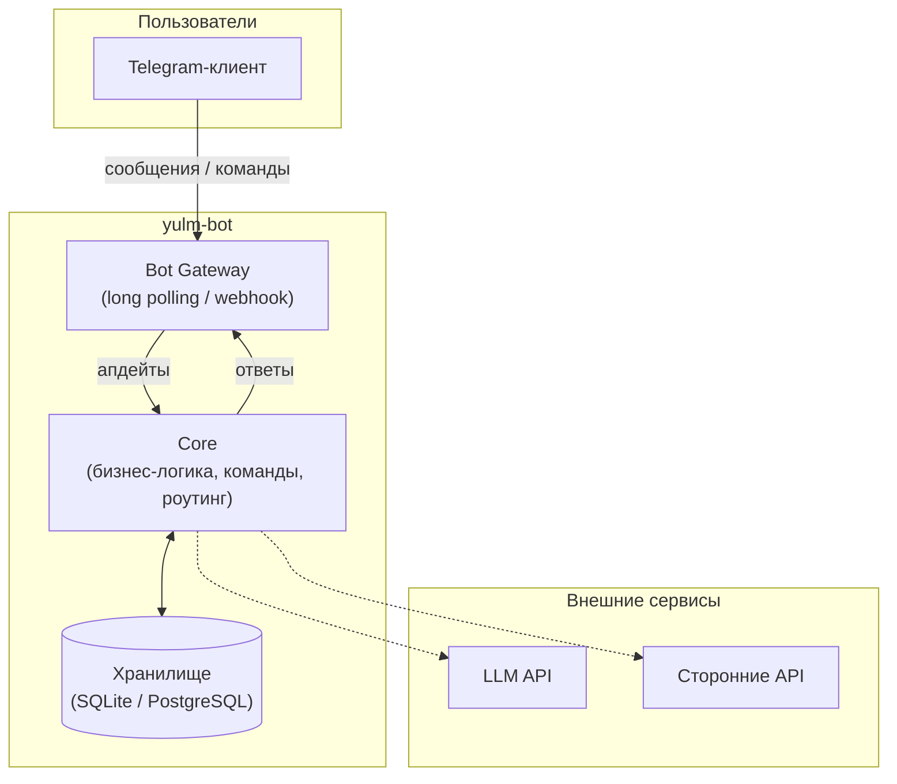

# 1. High-Level архитектура

Общий обзор системы `yulm-bot`: Telegram-бот как точка входа, ядро бизнес-логики,
внешние интеграции и хранилище данных.

## Основные слои

1. **Gateway** — приём и отправка сообщений Telegram (aiogram/python-telegram-bot).
2. **Core** — маршрутизация команд, контекст диалога, бизнес-правила.
3. **Storage** — персистентные данные: пользователи, сессии, настройки.
4. **Integrations** — необязательные внешние сервисы (LLM, сторонние API).
