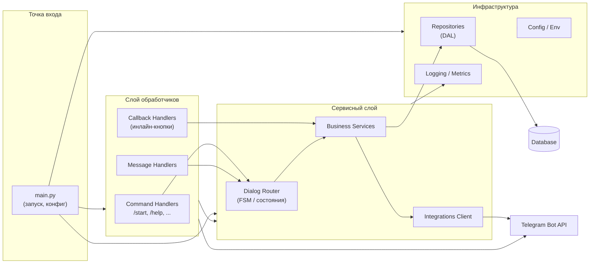

# 2. Диаграмма компонентов

Внутреннее устройство бота: модули и зависимости между ними.

## Назначение компонентов

| Компонент | Ответственность |
|---|---|
| `main` | инициализация, запуск polling/webhook |
| `Handlers` | тонкий слой: валидация входа, вызов сервисов |
| `Dialog Router` | машина состояний диалога (FSM) |
| `Business Services` | правила, сценарии, интеграционная логика |
| `Repositories` | доступ к данным (Data Access Layer) |
| `Integrations Client` | обёртки над внешними API |
| `Config` | переменные окружения, секреты |
