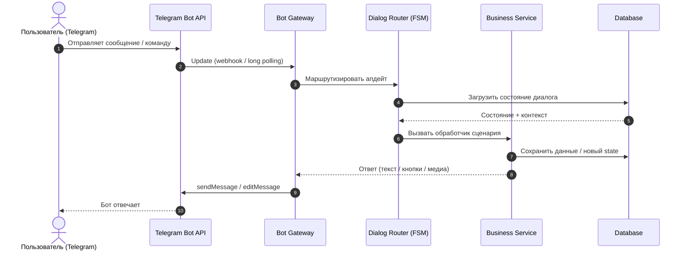

# 3. Sequence-диаграмма: обработка сообщения

Типовой сценарий: пользователь отправляет сообщение боту.

## Варианты сбоев

- **Timeout внешнего API** — повтор с экспоненциальной задержкой, деградация до ответа «попробуйте позже».
- **Ошибка записи в БД** — транзакция откатывается, пользователю возвращается нейтральное сообщение, ошибка логируется.
