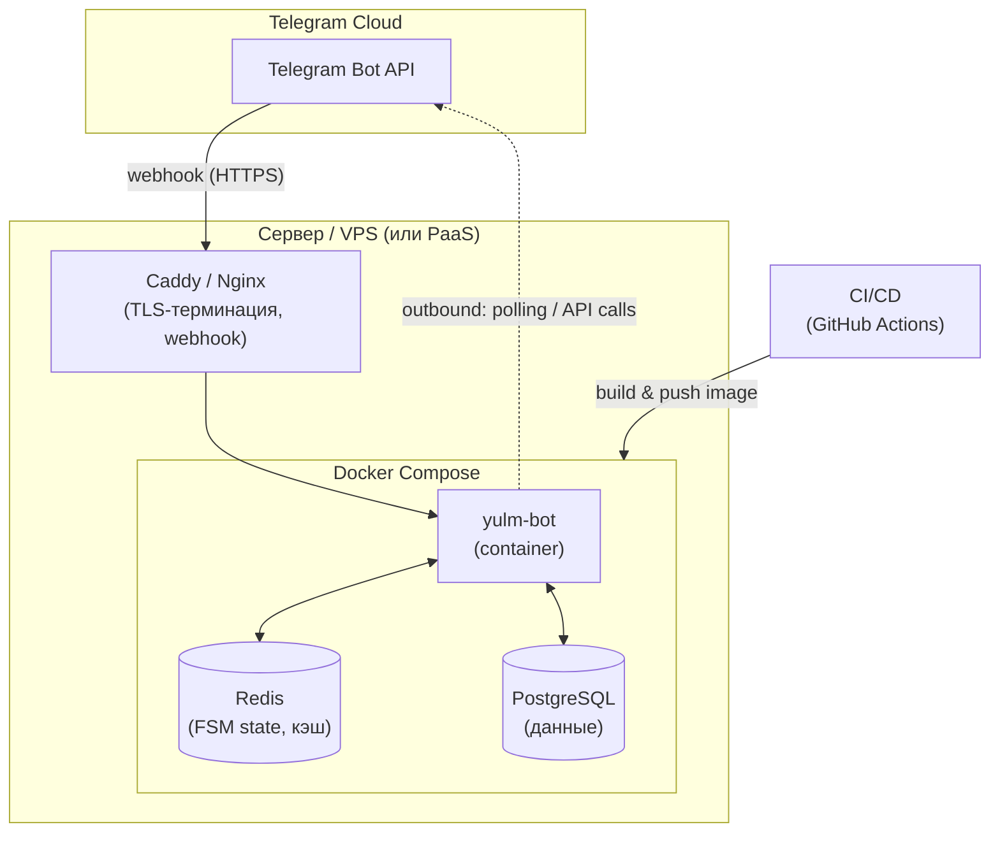

# 4. Схема развёртывания (Deployment)

## Режимы запуска

| Режим | Когда использовать |
|---|---|
| **Long polling** | разработка, нет публичного HTTPS |
| **Webhook + reverse proxy** | прод, выше производительность |

## Компоненты инфраструктуры

- **PostgreSQL** — основные данные; для MVP допустима замена на SQLite.
- **Redis** — состояния FSM и кэш; опционально (можно memory storage в dev).
- **Caddy/Nginx** — TLS для webhook.
- **GitHub Actions** — линты, тесты, сборка образа, деплой.
