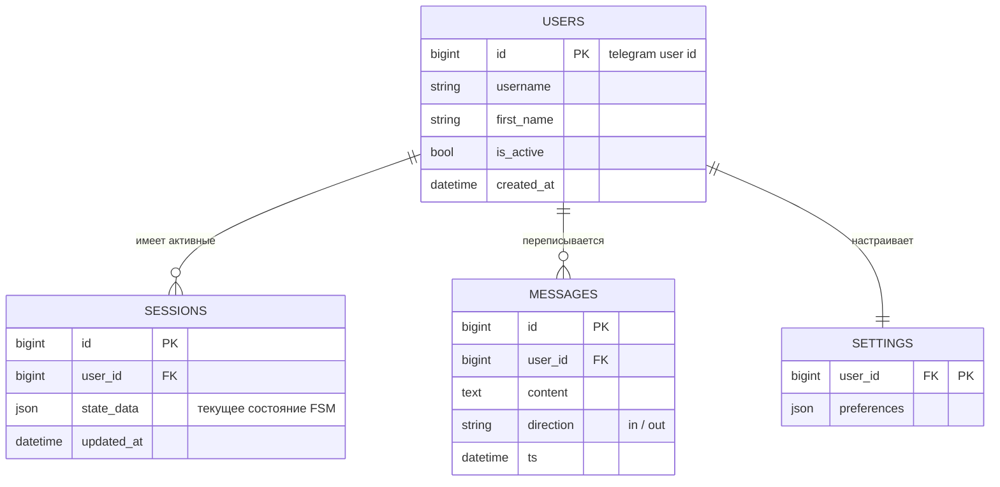

# 5. Модель данных

ER-диаграмма основной персистентной модели.

## Примечания

1. `SESSIONS.state_data` сериализуется aiogram FSM (SqliteStorage/RedisStorage) либо аналогом.
2. `MESSAGES` нужен для истории диалога и аналитики; при росте — партиционирование по месяцам.
3. Секреты (токен бота, API-ключи) **не хранятся в БД** — только через переменные окружения.
