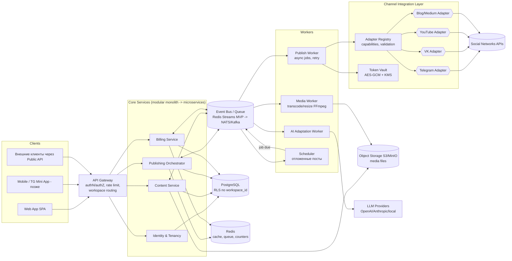

# 03. High-Level архитектура

## Схема (Mermaid)

## Выбор технологий (предложение, обсуждаемо)

| Слой | MVP | Рост | Почему |
|---|---|---|---|
| Язык/рантайм | TypeScript (Node.js/NestJS) или Python (FastAPI) — один язык на всё | тот же | Одна команда, общая кодовая база адаптеров; TS выигрывает если фронт тоже React |
| Фронт | React + Vite, TipTap/ProseMirror (WYSIWYG), CodeMirror (MD) | Next.js SSR для публичных страниц | Нужен серьёзный редактор с diff-просмотром версий |
| БД | PostgreSQL 16 | + read replicas, партиционирование журналов | RLS из коробки = дешёвая изоляция tenant'ов; JSONB для payloads адаптеров |
| Очередь | Redis Streams (+ BullMQ) | RabbitMQ / NATS JetStream / Kafka | BullMQ даёт retry/backoff/priority из коробки; миграция простая при event-контрактах |
| Хранилище файлов | MinIO (self-hosted) → S3-совместимый облачный | CDN для превью | Один контракт S3 API везде |
| Шина событий | та же Redis (streams) | NATS JetStream | Не заводем Kafka ради 5 событий в секунду |
| Auth | Lucia/Auth.js + JWT (short-lived) + refresh | Keycloak/OIDC при SSO-требованиях клиентов | Workspace-скоуп в токенене |
| Биллинг | Stripe Billing (test mode) | Paddle/ЮKassa по рынку | Не пишем свои счета/налоги/PCI |
| Контейнеры | Docker Compose | Kubernetes (только когда >10 сервисов и 2+ команды) | k8s на старте = оверинжиниринг |
| CI/CD | GitHub Actions: lint→test→build→deploy compose | Helm/ArgoCD | Простой pipeline, contract-тесты адаптеров |
| Наблюдаемость | pino logs + Prometheus/Grafana + Sentry | OpenTelemetry traces между сервисами | Обязателен дашборд: queue depth, publish success rate |

## Ключевые архитектурные решения (ADR-выжимка)

**ADR-1. Modular monolith → микросервисы.** Сервисы контекстов живут в одном репозитории и (на MVP) одном процессе, но общаются только через внутренние контракты (interfaces + events). Вынос контекста в отдельный деплойменяет способ вызова, не логику. Триггеры выноса: Publish Worker (изоляция long-running задач от UI), Media Worker (CPU-heavy), AI Worker (cost control/провайдеры).

**ADR-2. Адаптеры как плагины с манифестом.** Каждый канал описывает `capabilities` (тип контента, лимиты символов, media-форматы, поддержка scheduling), которые ядро использует для валидации и генерации превью. Тесты адаптеров прогоняются против фикстур API (VCR-записи реальных ответов) + песочницы площадок.

**ADR-3. Публикация — это job, а не запрос.** HTTP-запрос создаёт `PublicationJob` и возвращает 202 + job_id; выполнение асинхронное; статус пушится в UI через WebSocket/SSE. Гарантии: at-least-once доставка задачи + идемпотентность публикации (`idempotency_key = hash(job, channel)`), что защищает от дублей при ретраях.

**ADR-4. Изоляция tenant'ов на уровне БД.** Все таблицы доменных данных содержат `workspace_id NOT NULL`; политики RLS PostgreSQL включены; соединение открывается с `SET app.workspace_id`. Двойная защита: middleware проверяет ownership, RLS страхует от ошибок в коде.

**ADR-5. Секреты площадок не покидают Vault.** Только Token Vault расшифровывает креды; воркеры получают ephemeral-секрет на время задачи; аудит доступа к секретам. Ротация токенов OAuth (refresh flow) — фоновая задача Vault.

## Потоки данных (кратко)

1. **Загрузка**: UI → presigned URL → S3; событие `media.uploaded` → Media Worker готовит вариации.
2. **Создание материала**: Content Service хранит версию; события идут в AI Worker (предложить адаптации) и в UI-превью.
3. **Публикация**: Publishing валидирует entitlements (Billing) → создаёт attempts по каналам → очередь → Publish Worker берёт задачу, запрашивает креды у Vault, дергает адаптер → результат в attempt + журнал + UsageCounter.
4. **Расписание**: Scheduler раз в минуту сканирует `ScheduleRule(due)` → эмитит job в шину.

Детализация publication flow — в [06-publishing-flow.md](06-publishing-flow.md); схемы sequence/deployment/ER — в каталоге `diagrams/`.
