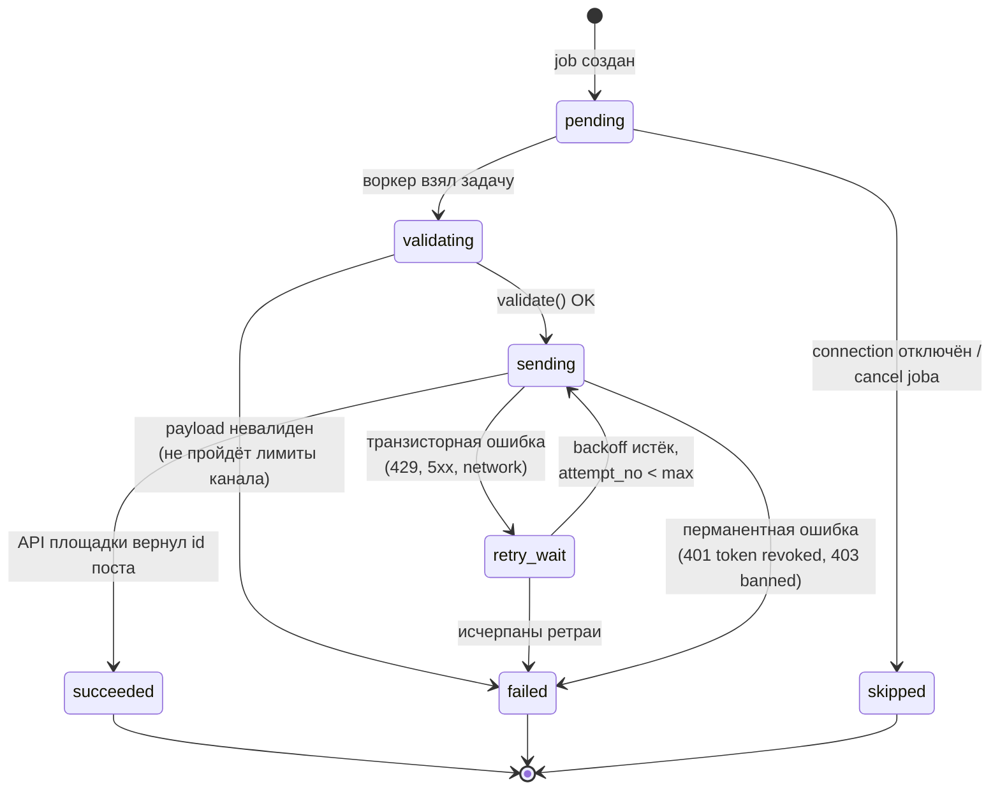
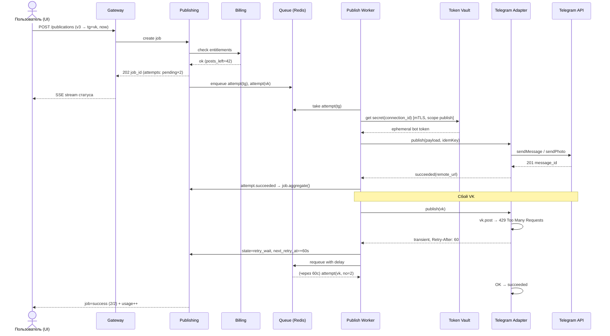

# 06. Flow публикации (state machine, retry, частичный успех)

## Диаграмма состояний PublicationAttempt



Правила:
- **Транзисторные ошибки** (rate limit, таймаут): повтор с экспоненциальным backoff + jitter (1м→5м→15м→1ч, максимум N). При 429 уважаем `Retry-After` площадки.
- **Перманентные ошибки** (отозванный токен, забаненный канал): сразу `failed`, помечаем `account_connections.status = reauth_required`, уведомляем пользователя в UI/email — не долбим API.
- **Terminal-статусы неизменяемы**; повтор публикации пользователем = новый attempt (свежий idempotency_key), а не сброс старого.

## Job = агрегат attempts

```
POST /api/publications {version_id, connections[], scheduled_for?}
  ├─ Billing.checkEntitlement(workspace, posts_remaining, channels_active)  ─ нет → 402 Upgrade
  ├─ Integration.validate(payload × каждый канал)                            ─ часть невалидна → warning, но job создаётся
  ├─ create PublicationJob(queued) + N Attempts(pending)                     идемпотентно по client request key
  └─ 202 Accepted {job_id} → SSE/WebSocket статус в реальном времени

Job status = f(attempts): все succeeded → success; mix → partial_success;
все failed → failed; есть pending/retry → running.
```

Частичный успех — продукт, а не баг: UI показывает «3 из 5 опубликовано, VK — retry сейчас / IG — токен отозван, перевыйдите». Кнопки per-channel: retry, cancel, edit-and-retry.

## Идемпотентность и безопасность повторов

1. Клиентский ключ: повторный POST того же запроса (network hiccup в UI) возвращает существующий job (`Idempotency-Key` заголовок, таблица `idempotency_keys`).
2. Ключ на отправку: `hash(job_id, connection_id)` хранится у attempt; если воркер упал после отправки но до записи результата — при повторном взятии задачи адаптер проверяет удалённый пост (у части API есть search-by-idempotency или мы пишем свой marker-хеш в alt-текст/first comment). Худший случай — дубль поста, поэтому at-least-once + максимально возможная exactly-once эвристика.
3. Scheduler не создаёт второй job для той же `schedule_rule`, пока предыдущий не terminal (защита от зависания воркера через lease timeout).

## Последовательность (happy path + retry)



## Отложенные публикации (расписание)

- `ScheduleRule` строка с cron/разовым timestamp + tz workspace'а (публикуем «в 10:00 по Москве» даже когда сервер UTC).
- Scheduler (leader-elected) сканирует due-правила каждые 30–60с → эмитит jobs в ту же шину. Пропущенные окна (упал scheduler) компенсируются при следующем скане с флагом `late=true` (политика: публиковать запоздало или skip — настройка workspace).
- Часовые пояса и DST — тестировать отдельно, классический источник багов планировщиков.

## Что видит пользователь (UX-гарантии)
- Статус каждой площадки в реальном времени (SSE/WSS), без polling.
- Причина отказа человеческим языком + действие («переподключить VK», «сократите текст на 120 символов»).
- Полная история публикаций материала: где, когда, каким текстом (adapted_payload), ссылка на пост.
